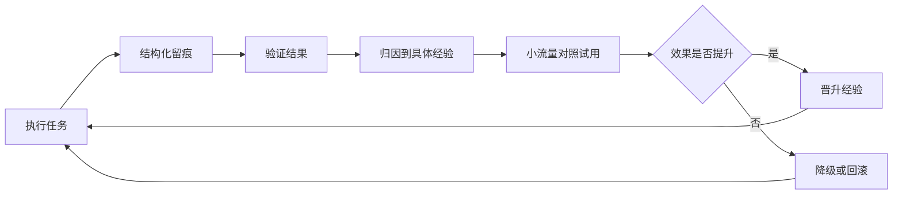

> 这轮实践最重要的收获，不是让模型生成更多内容，而是让每一次选择都有证据，让每一条经验都能被验证和撤销。

## 一、先把“自主学习”拆清楚

一个 AI 应用能记住用户、调整语气、总结经验，并不等于模型在自己更新权重。对当前系统来说，学习主要发生在**数据层和策略层**：写入记忆、调整偏好、积累技巧，再在后续对话中使用这些经验。

把现有能力映射到“数据、算法、反馈”三层，会得到这样的结构：

| 层 | 当前实现 | 主要问题 |
|---|---|---|
| 数据 | 会话增量提炼、记忆去重合并、可撤销的记忆链 | 已有基础 |
| 归纳 | LLM 提炼经验、偏好规则调整、主动发现知识空白 | 能生成候选经验 |
| 反馈 | 技能成功率、复盘生成 tips、授权后写入 | 尚未形成完整闭环 |

最大的缺口在反馈层。过去的 `success` 很多时候只代表“没有抛异常”，并不代表回答正确，更不代表用户满意。复盘产生的 tip 如果直接进入 prompt，却没有采纳后的效果验证，系统就可能越学越啰嗦，甚至不断放大错误经验。

因此，真正的学习闭环应该是：



**没有验证和回滚的“学习”，更像是在持续追加上下文。**

## 二、先会选择技能，再考虑获取新能力

项目里原本已经有 researcher、writer、coder 等技能，但它们只挂在独立接口上，没有进入主聊天链路。也就是说，她“拥有技能”，却不知道什么时候应该使用。

这一阶段定下的原则是：

> 先让她有选择运用的能力，再给她获取能力的权限。

具体落地时，重点不是增加技能数量，而是补齐选择机制：

1. **默认不动手**：陪伴和闲聊优先，只有明确任务或时效性信息需求才触发工具。
2. **规则优先于 LLM 判定**：天气、新闻等明确请求先走规则路由，减少冷启动延迟和误判。
3. **结果回到聊天链路**：检索结果不是直接甩给用户，而是经过合成，保持角色的表达风格。
4. **每次调用都有记录**：通过 journal 和 trace 证明技能确实执行过。
5. **保留总开关和降级路径**：关闭路由或检索失败时，聊天仍然可用。

验收也不能只看“回答像不像对了”。这轮曾出现过一次典型误判：天气请求的首字延迟突然从二十多秒降到两三秒，看起来像是检索优化生效，实际却是路由没有触发，模型在凭空编天气。

所以，**延迟变快不一定是优化生效，也可能是系统没有执行任务。** 延迟、日志、trace 和结果内容必须一起验收。

## 三、思考可观测，不等于展示一段思维链

“她是不是在思考”很难通过一段看似合理的推理文本来证明。模型可以生成事后解释，文字流畅也不代表这些中间内容真正影响了行动。

更可靠的做法是记录结构化的决策轨迹，并通过干预实验检查因果关系。

当前留痕分为四步：

- `think`：保存本轮判断及消息快照；
- `act`：记录是否调用技能、调用了什么；
- `observe`：记录工具返回和观察到的信息；
- `reply`：记录最终回复及耗时。

重放器则支持删除事实、替换中间文本、移除部分上下文，并设置不做修改的对照组。判断方法也不只看文本差异，而是结合：

- LLM 判官：结论是否发生实质变化；
- 确定性探针：应当出现或消失的内容是否符合预期；
- 对照组：不干预时，输出自身就有多大波动。

这里得到的第二个重要教训是：**如果对照组自身波动就很大，干预实验得到的差异很可能只是噪声。**

因此，在做“思考因果性”测量之前，必须先降低采样方差，同时解决检索素材中的日期和数值冲突。否则，实验测到的不是中间结论的作用，而是模型每次随机挑选了不同素材。

## 四、检索稳定性比复杂提示词更优先

这轮检索优化主要做了几件事：

| 优化 | 实测作用 |
|---|---|
| 30 分钟搜索缓存，LRU 上限 128 | 重复查询从约 5.24 秒降到接近 0 秒 |
| 减少不必要的交叉验证 | 降低 SerpAPI 消耗和 researcher 耗时 |
| 时效性过滤与日期分桶 | 避免把不同日期的天气、新闻混在一起 |
| 主源取值 | 明确要求以最新、最相关的来源为准 |
| 对话温度默认设为 0 | 降低同一问题多次回答的采样差异 |

在同一问题连续五次的稳定性验证中，回答中的数值都落在主源区间内，没有出现虚构温度。仍有一个小残留：其中一次只描述“温差大”，没有给出明确数字。后续需要补充规则——**主源存在明确数值时，回答必须给出对应区间。**

这个过程让我更确认：很多看似“模型推理不稳定”的问题，实际上是输入素材不稳定。先治理数据，再讨论模型能力，通常更有效。

## 五、一次尾延迟排查：真正的瓶颈藏在哪里

稳定性验证最后一轮仍出现过一次约 20 秒的首字延迟。为了定位它，逐层做了排除：

| 假设 | 验证结果 |
|---|---|
| 同步 urllib 阻塞事件循环 | 部分成立，移入线程池后仍有尖峰 |
| 多个后台任务并发调用 API | 串行化后明显改善，但没有完全消失 |
| 搜索过慢 | 缓存命中时搜索耗时接近 0，不是主因 |
| DNS、TCP 或 TLS 握手慢 | 裸 socket 探针显示握手约 0.1 秒 |
| 后台线程池排队 | 函数内部与外部计时一致，排除排队 |
| 非流式请求等待响应头 | 日志显示总耗时 23 秒，其中约 20.3 秒在等待响应头 |

最终确认：主要长尾来自**前台合成使用了非流式接口**。流式请求的首字节通常在 0.2–1.4 秒，而非流式请求会间歇性等待响应头 7–25 秒。

修复分为三层：

1. 前台 researcher 合成和后续问题提取改走流式接口；
2. 记忆提取、滚动摘要、会话提炼、自主规划进入后台单线程队列；
3. 非流式超时从 60 秒收紧到 20 秒，STT 预加载改为等待对话静默后再执行。

最终进行了三轮共 33 次复测：首字延迟为 **1.02–6.89 秒**，没有一次达到 9 秒；修复前则出现过 25.6、20.2 和 13.9 秒。复测时同时检查了回复确实来自正常合成，没有因为报错而悄悄走降级文本。

**性能优化不能只看平均值，也不能只看是否变快。必须知道时间花在哪一层，并确认功能没有被静默跳过。**

## 六、后台串行队列的具体逻辑

后台队列不是手写的消息队列，而是“专用单线程池 + 线程池内部队列 + async/await 桥接”：

```python
import asyncio
from concurrent.futures import ThreadPoolExecutor

_bg_executor = ThreadPoolExecutor(
    max_workers=1,
    thread_name_prefix="bg-llm",
)

async def run_background(fn, *args):
    return await asyncio.get_running_loop().run_in_executor(
        _bg_executor, fn, *args
    )
```

`run_in_executor` 和 `max_workers=1` 解决的是两个不同问题：

- `run_in_executor`：把同步阻塞函数移出事件循环；
- `max_workers=1`：让进入这个线程池的任务逐个执行，避免多个后台非流式请求互相拖慢。

另一个容易混淆的地方是：`run_background` 本身会等待结果，并不是“发射后不管”。聊天后的记忆提取之所以不阻塞当前回复，是因为外层使用了 `asyncio.create_task`，并且在回复生成结束后才启动。

这个机制也有明确边界：

- 只覆盖显式调用 `run_background` 的任务；
- 前台流式请求不经过队列，仍可能与唯一后台任务并行；
- 没有统一的队列长度限制、优先级和背压；
- 网络超时不包含排队等待时间；
- 只在当前 Python 进程内串行，多进程部署不能形成全局限流。

## 七、下一步：让经验真正可验证、可回滚

目前技能路由、思考留痕、重放器和检索稳定性已经具备基础。接下来需要完成判分异步化和指标基线，再进入学习闭环：

1. 为 tip 增加采纳次数、采纳后成功次数和版本号；
2. 每轮记录实际注入了哪些 tip，让结果能够归因；
3. 用小流量对照实验决定经验晋升还是回滚；
4. 离线重放低分轨迹，候选经验先进入确认队列，而不是直接污染 prompt；
5. 持续观察 tip 数量是否收敛、同类问题重问率是否下降。

最后把这轮学习摘要压缩成四句话：

- **先会选择，再获取能力。**
- **先留下证据，再讨论思考。**
- **先建立基线，再宣称优化。**
- **能验证、能回滚的经验，才配叫作学习。**
