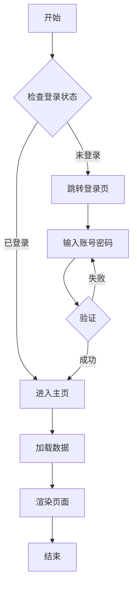

## 图片灯箱测试

点击下方图片，应该弹出深色遮罩 + 放大查看。


按 ESC 或点击背景关闭。

---

## Mermaid 流程图



---

## KaTeX 数学公式

行内公式：$E = mc^2$

块级公式：

$$
\int_{0}^{\infty} e^{-x^2} dx = \frac{\sqrt{\pi}}{2}
$$

矩阵：

$$
\begin{pmatrix}
a & b \\
c & d
\end{pmatrix}
\begin{pmatrix}
x \\
y
\end{pmatrix}
=
\begin{pmatrix}
ax + by \\
cx + dy
\end{pmatrix}
$$

---

## 代码块（原有功能）

```python
def fibonacci(n):
    a, b = 0, 1
    for _ in range(n):
        a, b = b, a + b
    return a
```

---

## 总结

| 功能 | 状态 |
|------|------|
| 🖼️ 图片灯箱 | ✅ 点击放大 |
| 📐 Mermaid | ✅ 流程图渲染 |
| 📝 KaTeX | ✅ 数学公式 |
| 💬 访客留言 | ✅ 免登录评论 |
